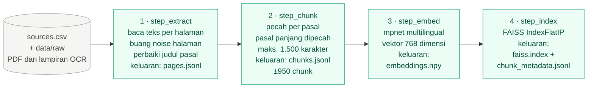
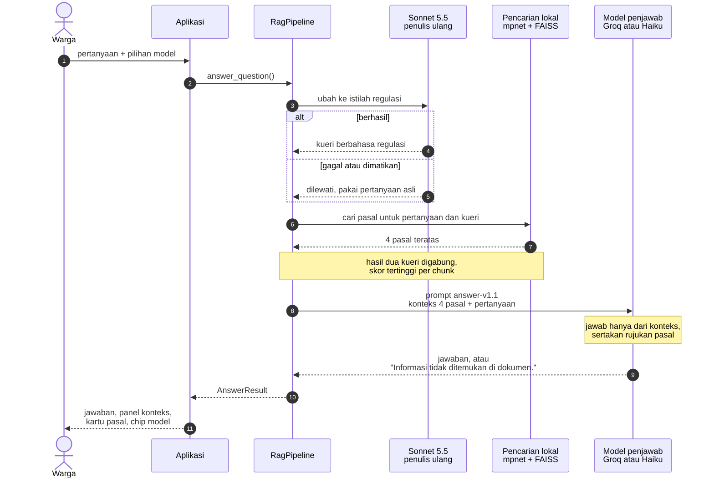
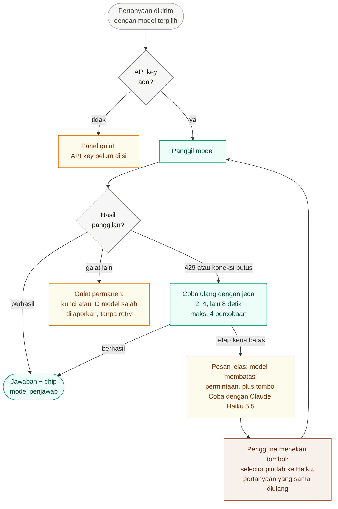
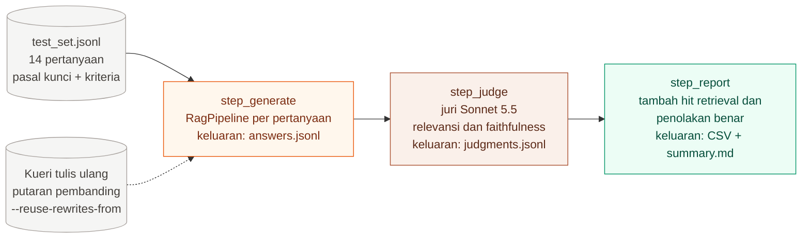
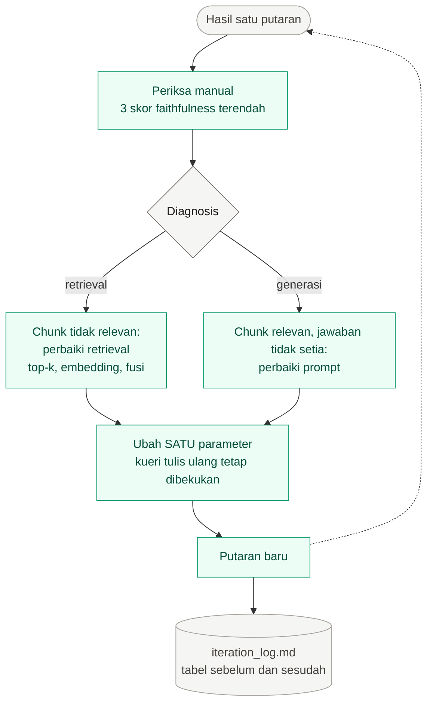

# Alur Kerja DUKCAPIL-Pintar

Dokumen ini menggambarkan cara prototipe RAG v1 bekerja, dari PDF regulasi sampai jawaban
yang menyebut pasal rujukannya. Diagram memakai [Mermaid](https://mermaid.js.org/), jadi tampil
langsung di GitHub dan bisa diubah sebagai teks.

**Keterangan warna** (berlaku di semua diagram):

| Warna | Arti |
|---|---|
| Hijau | Berjalan **lokal** di mesin sendiri (tanpa mengirim teks ke provider) |
| Jingga | **Groq** (`openai/gpt-oss-120b`), jalur generasi utama |
| Clay | **Anthropic** (Claude Sonnet 5.5 dan Haiku 5.5) |
| Abu | Data, berkas, pengguna, dan titik keputusan |
| Kuning | Galat atau peringatan yang ditampilkan ke pengguna |

---

## 1. Gambaran besar

Tiga jalur memakai indeks regulasi yang sama: pembuatan indeks (sekali), aplikasi untuk warga
(tiap pertanyaan), dan evaluasi (tiap putaran uji). Aplikasi dan evaluasi memakai kelas
`RagPipeline` yang sama, sehingga yang dievaluasi persis yang didemokan.

---

## 2. Pembuatan indeks (offline, sekali jalan)

`python scripts/build-index.py` menjalankan empat langkah berurutan. Tiap langkah menyimpan
keluarannya, sehingga bisa dijalankan sebagian dengan `--only`, misalnya `--only embed,index`.

Alasan chunk per pasal: peraturan berstruktur jelas, satu pasal umumnya satu ketentuan utuh, dan
jawaban harus bisa menyebut nomor pasal. Tiap chunk diawali header `[Perpres 96/2018 · Pasal 34]`
yang ikut di-embed, agar pertanyaan yang menyebut nama regulasi atau nomor pasal lebih mudah
menemukan potongannya. Bagian Penjelasan dan butir perubahan pada UU perubahan diberi label
tersendiri supaya tidak tertukar dengan batang tubuh.

---

## 3. Menjawab satu pertanyaan (online)

Urutan yang terjadi tiap kali warga bertanya. Penulis ulang kueri bersifat opsional
(`DUKCAPIL_QUERY_REWRITE`) dan kegagalannya tidak menggagalkan jawaban.

Yang ditampilkan ke warga selalu memuat: jawaban, konteks yang diambil (bisa disalin), kartu
pasal dengan tautan ke sumber resmi, dan chip "Dijawab oleh {model}". Token dan latency hanya
dicatat untuk evaluasi, tidak tampil di antarmuka.

---

## 4. Pembagian peran model

| Tahap | Model | Lokasi | Catatan |
|---|---|---|---|
| Embedding pertanyaan dan pasal | `paraphrase-multilingual-mpnet-base-v2` | Lokal | Wajib lokal (syarat RTM 2). Puncak memori ±1,9 GB |
| Penulis ulang kueri | Claude Sonnet 5.5 | Anthropic | Opsional, bisa dimatikan |
| Penjawab utama (default) | Groq `openai/gpt-oss-120b` | Groq | Jalur generasi utama sesuai ketentuan RTM 2 |
| Penjawab pembanding dan cadangan | Claude Haiku 5.5 | Anthropic | Dipilih manual atau lewat tombol saat Groq kena batas |
| Juri evaluasi | Claude Sonnet 5.5 | Anthropic | Berbeda dari penjawab default, jadi tidak menilai jawabannya sendiri |

---

## 5. Rate limit dan model cadangan

Model yang tampil di antarmuka selalu model yang benar-benar menjawab. Sistem **tidak pernah**
berpindah model diam-diam: pindah ke Haiku hanya terjadi saat pengguna menekan tombolnya.

---

## 6. Evaluasi dan iterasi

### 6a. Satu putaran evaluasi

`python scripts/run-evaluation.py --run-name <nama>` menjalankan tiga langkah. Tiap jawaban dan
penilaian ditulis segera, jadi putaran yang terputus (mis. rate limit) bisa dilanjutkan dengan
perintah yang sama.

Faithfulness dinilai dengan memecah jawaban menjadi klaim, lalu tiap klaim ditandai DIDUKUNG atau
TIDAK DIDUKUNG oleh konteks. Hit retrieval dan penolakan benar dihitung tanpa juri, langsung dari
pasal yang diambil dan dari kalimat "tidak ditemukan".

### 6b. Siklus iterasi

Dua hal dijaga agar perbandingan antarputaran jujur: hanya **satu** parameter berubah per putaran,
dan kueri tulis ulang dibekukan dari putaran pembanding karena penulis ulang tidak deterministik
(tanpa itu, retrieval ikut berubah antarputaran).

---

## 7. Peta berkas

| Tahap | Berkas |
|---|---|
| Baca PDF dan bersihkan teks | `dukcapil_pintar/ingestion.py` |
| Pecah per pasal | `dukcapil_pintar/chunking.py` |
| Embedding lokal | `dukcapil_pintar/embedding.py` |
| Indeks FAISS dan penggabungan hasil | `dukcapil_pintar/retrieval.py` |
| Prompt penjawab, penulis ulang, dan juri (berversi) | `dukcapil_pintar/prompts.py` |
| Klien Groq dan Anthropic, retry, rate limit | `dukcapil_pintar/providers.py` |
| Tulis ulang kueri dan susun jawaban | `dukcapil_pintar/generation.py` |
| Alur end-to-end | `dukcapil_pintar/pipeline.py` |
| Antarmuka | `app.py`, `dukcapil_pintar/ui.py` |
| Parameter dan daftar model | `dukcapil_pintar/config.py` |
| Pembuatan indeks | `scripts/build-index.py` |
| Evaluasi | `scripts/run-evaluation.py` |
