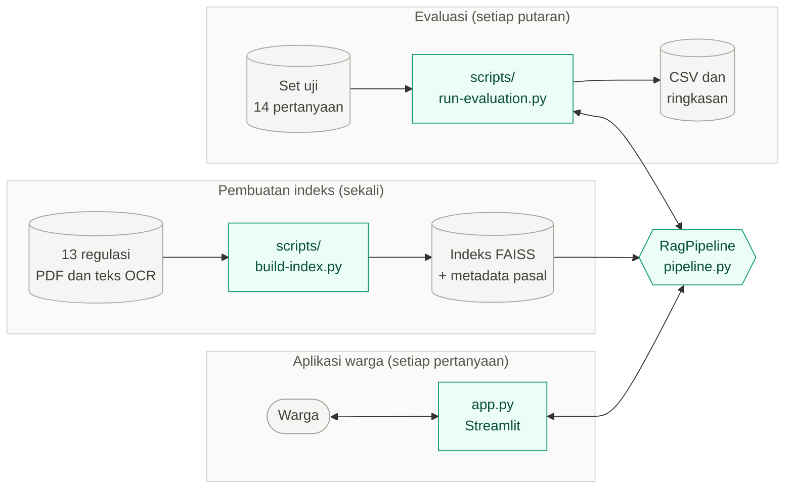
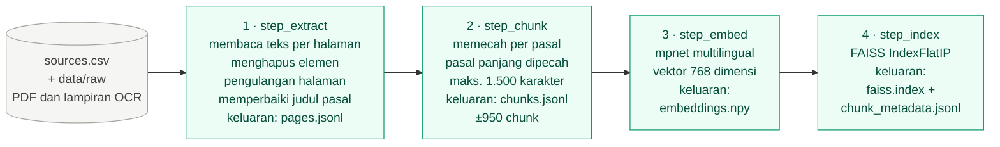
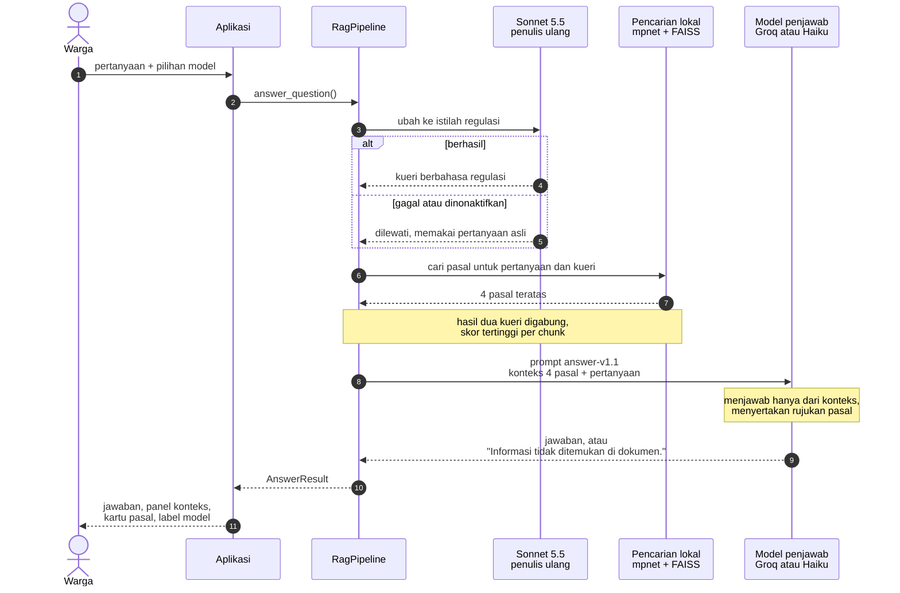
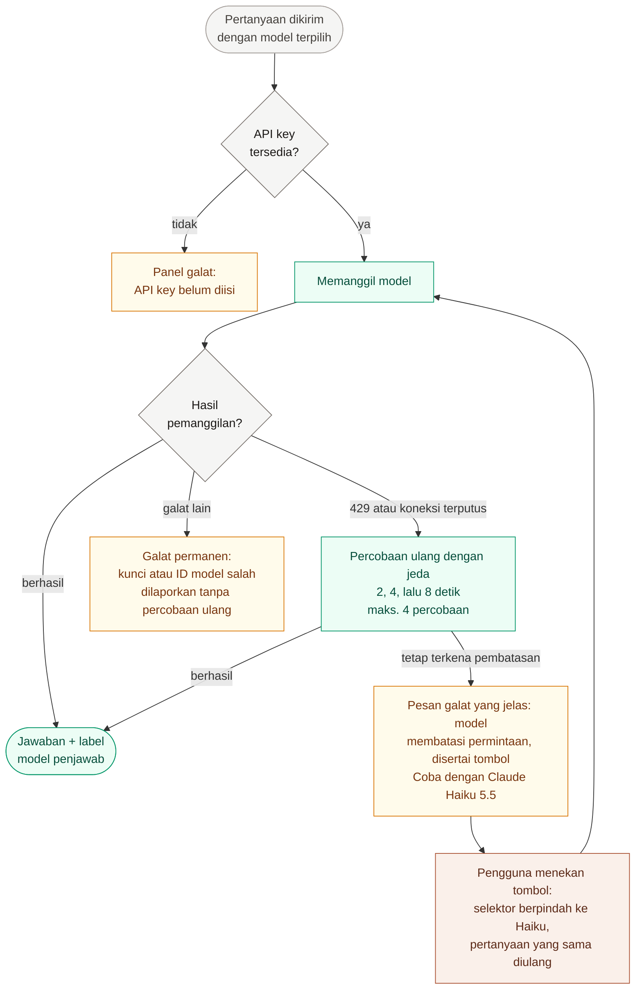
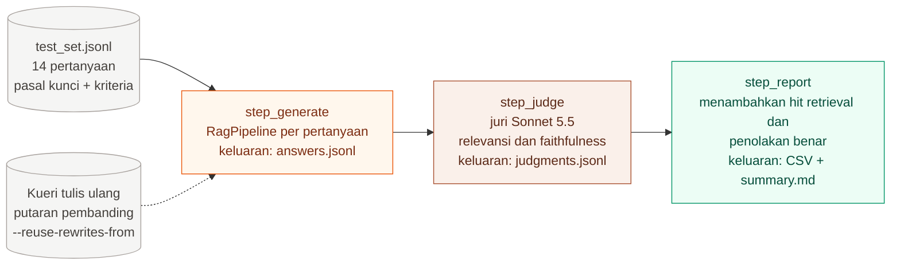
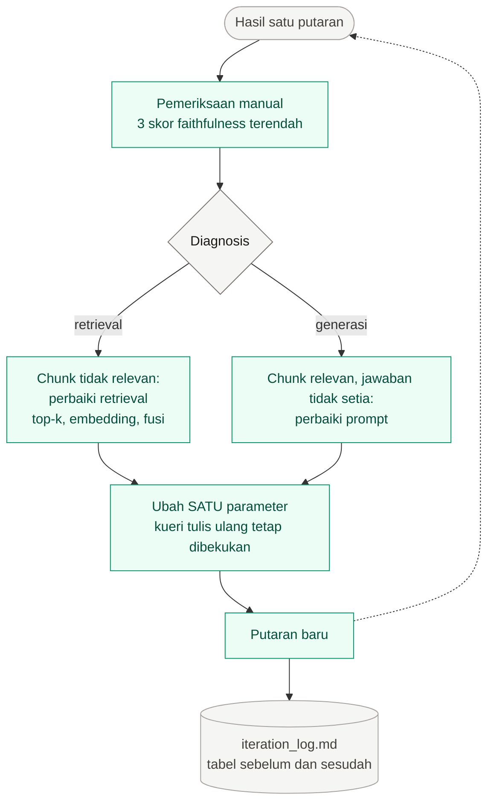

# Alur Kerja DUKCAPIL-Pintar

Dokumen ini menguraikan cara kerja prototipe RAG v1, mulai dari berkas PDF regulasi hingga
jawaban yang menyebutkan pasal rujukannya. Diagram disusun dengan [Mermaid](https://mermaid.js.org/)
sehingga dapat ditampilkan langsung pada GitHub dan dapat disunting sebagai teks.

**Keterangan warna** (berlaku pada seluruh diagram):

| Warna | Arti |
|---|---|
| Hijau | Berjalan **secara lokal** pada perangkat sendiri (teks tidak dikirim ke penyedia layanan) |
| Jingga | **Groq** (`openai/gpt-oss-120b`), jalur generasi utama |
| Clay | **Anthropic** (Claude Sonnet 5.5 dan Haiku 5.5) |
| Abu-abu | Data, berkas, pengguna, dan titik keputusan |
| Kuning | Galat atau peringatan yang ditampilkan kepada pengguna |

---

## 1. Gambaran umum

Tiga jalur menggunakan indeks regulasi yang sama, yaitu pembuatan indeks (sekali), aplikasi bagi
warga (setiap pertanyaan), dan evaluasi (setiap putaran pengujian). Aplikasi dan evaluasi
menggunakan kelas `RagPipeline` yang sama sehingga yang dievaluasi identik dengan yang
didemonstrasikan.

---

## 2. Pembuatan indeks (luring, satu kali)

Perintah `python scripts/build-index.py` menjalankan empat langkah secara berurutan. Setiap
langkah menyimpan keluarannya sehingga dapat dijalankan sebagian dengan opsi `--only`, misalnya
`--only embed,index`.

Pemecahan chunk per pasal dipilih karena peraturan perundang-undangan berstruktur jelas, satu
pasal umumnya memuat satu ketentuan utuh, dan jawaban harus dapat menyebutkan nomor pasal. Setiap
chunk diawali header `[Perpres 96/2018 · Pasal 34]` yang turut di-*embed* agar pertanyaan yang
menyebut nama regulasi atau nomor pasal lebih mudah menemukan potongan yang sesuai. Bagian
Penjelasan dan butir perubahan pada undang-undang perubahan diberi label tersendiri agar tidak
tertukar dengan batang tubuh.

---

## 3. Menjawab satu pertanyaan (daring)

Urutan proses yang terjadi setiap kali warga mengajukan pertanyaan. Penulis ulang kueri bersifat
opsional (`DUKCAPIL_QUERY_REWRITE`) dan kegagalannya tidak menggagalkan jawaban.

Tampilan yang disajikan kepada warga selalu memuat jawaban, konteks yang diambil (dapat
disalin), kartu pasal beserta tautan ke sumber resmi, dan label "Dijawab oleh {model}". Jumlah
token dan latency hanya dicatat untuk keperluan evaluasi dan tidak ditampilkan pada antarmuka.

---

## 4. Pembagian peran model

| Tahap | Model | Lokasi | Catatan |
|---|---|---|---|
| Embedding pertanyaan dan pasal | `paraphrase-multilingual-mpnet-base-v2` | Lokal | Wajib lokal (persyaratan RTM 2). Puncak memori ±1,9 GB |
| Penulis ulang kueri | Claude Sonnet 5.5 | Anthropic | Opsional, dapat dinonaktifkan |
| Penjawab utama (bawaan) | Groq `openai/gpt-oss-120b` | Groq | Jalur generasi utama sesuai ketentuan RTM 2 |
| Penjawab pembanding dan cadangan | Claude Haiku 5.5 | Anthropic | Dipilih secara manual atau melalui tombol ketika Groq terkena pembatasan |
| Juri evaluasi | Claude Sonnet 5.5 | Anthropic | Berbeda dari penjawab bawaan sehingga tidak menilai jawabannya sendiri |

---

## 5. Pembatasan laju dan model cadangan

Model yang tampil pada antarmuka selalu merupakan model yang benar-benar menjawab. Sistem
**tidak pernah** berpindah model tanpa sepengetahuan pengguna: perpindahan ke Haiku hanya terjadi
ketika pengguna menekan tombol yang tersedia.

---

## 6. Evaluasi dan iterasi

### 6a. Satu putaran evaluasi

Perintah `python scripts/run-evaluation.py --run-name <nama>` menjalankan tiga langkah. Setiap
jawaban dan penilaian langsung ditulis ke berkas sehingga putaran yang terhenti (misalnya akibat
pembatasan laju) dapat dilanjutkan dengan perintah yang sama.

Faithfulness dinilai dengan memecah jawaban menjadi klaim, kemudian setiap klaim ditandai
DIDUKUNG atau TIDAK DIDUKUNG oleh konteks. Hit retrieval dan penolakan benar dihitung tanpa
juri, langsung dari pasal yang diambil dan dari kalimat "tidak ditemukan".

### 6b. Siklus iterasi

Dua prinsip dijaga agar perbandingan antarputaran sahih: hanya **satu** parameter yang diubah
pada setiap putaran, dan kueri tulis ulang dibekukan dari putaran pembanding karena penulis
ulang tidak deterministik (tanpa pembekuan, hasil retrieval ikut berubah antarputaran).

---

## 7. Peta berkas

| Tahap | Berkas |
|---|---|
| Membaca PDF dan membersihkan teks | `dukcapil_pintar/ingestion.py` |
| Memecah per pasal | `dukcapil_pintar/chunking.py` |
| Embedding lokal | `dukcapil_pintar/embedding.py` |
| Indeks FAISS dan penggabungan hasil | `dukcapil_pintar/retrieval.py` |
| Prompt penjawab, penulis ulang, dan juri (berversi) | `dukcapil_pintar/prompts.py` |
| Klien Groq dan Anthropic, percobaan ulang, pembatasan laju | `dukcapil_pintar/providers.py` |
| Penulisan ulang kueri dan penyusunan jawaban | `dukcapil_pintar/generation.py` |
| Alur menyeluruh (*end-to-end*) | `dukcapil_pintar/pipeline.py` |
| Antarmuka | `app.py`, `dukcapil_pintar/ui.py` |
| Parameter dan daftar model | `dukcapil_pintar/config.py` |
| Pembuatan indeks | `scripts/build-index.py` |
| Evaluasi | `scripts/run-evaluation.py` |
